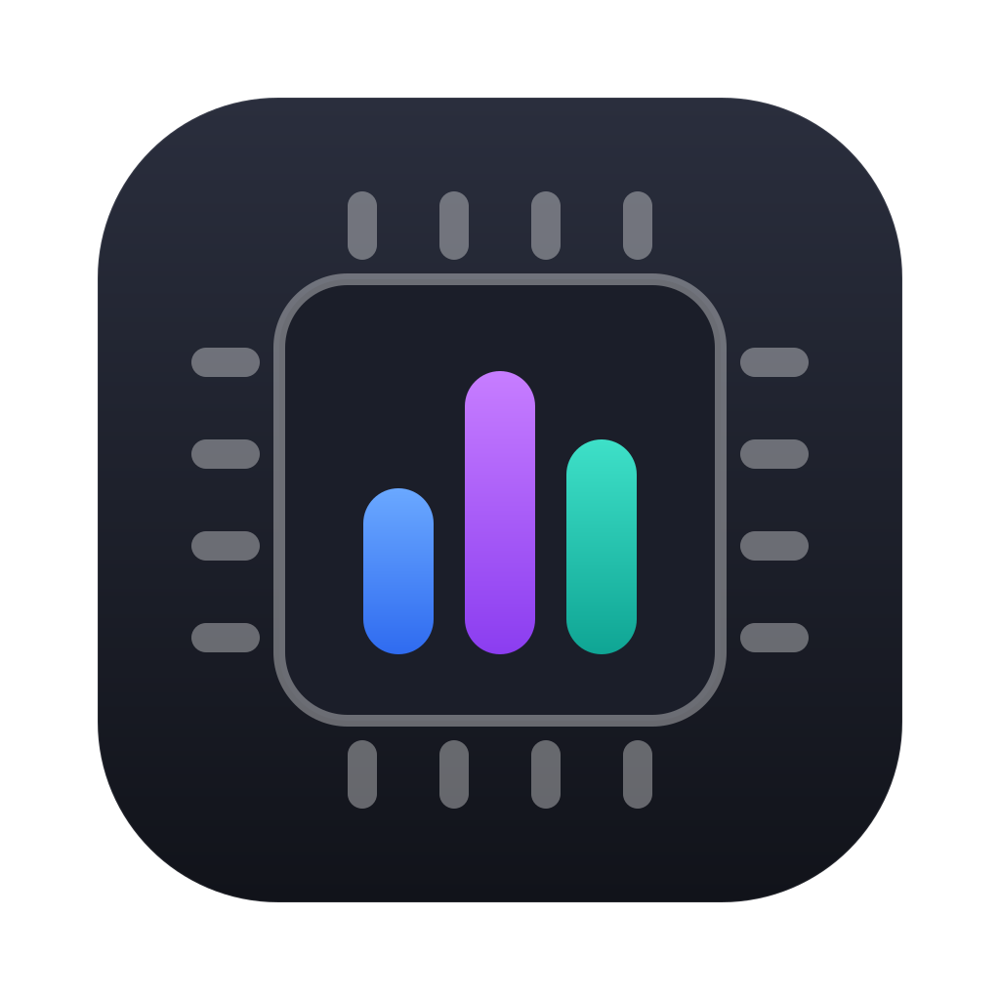
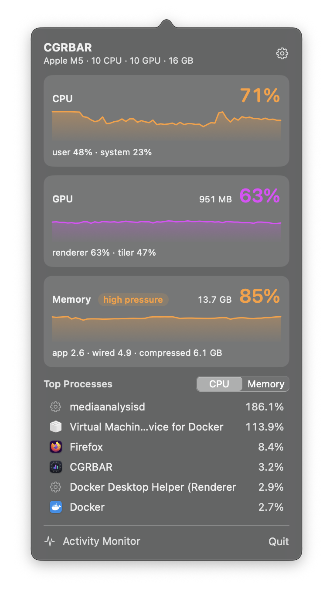
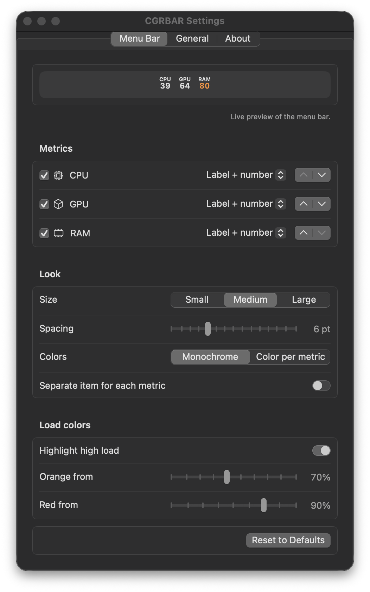

<p align="center">
  
</p>

<h1 align="center">CGRBAR</h1>

<p align="center">
  CPU, GPU and RAM in your menu bar. Native, tiny, no root.
</p>

<p align="center">
  
</p>

<p align="center">
  
</p>

## Features

- **Tiny in the menu bar.** By default each metric is a narrow column, a small
  label above the number. Values turn orange and red under high load.
- **Make it yours.** Pick a style for each metric: label + number, number,
  icon + number, a level bar or a small chart. Reorder metrics, change the size
  and spacing, color each metric, set your own load thresholds, or give every
  metric its own menu bar item. A live preview shows the result as you go.
- **Panel on click.** Live charts of recent load, the user/system CPU split,
  GPU renderer/tiler load and memory, a RAM breakdown with memory pressure,
  and the top processes by CPU or memory. Hover a running app to quit it.
- **Quick menu on right-click.** Show or hide metrics, change the update
  interval (1–10 s), open settings.
- **Light on your Mac.** About 14 MB of memory and well under 0.1% CPU at the
  default 2 s interval, whichever style you pick. The panel, the settings
  window and the process list only exist while they are open.

<p align="center">
  
</p>

## Install

Build it from source (see below), then move `build/CGRBAR.app` to
`/Applications`.

The app is not notarized. On first launch, right-click it in Finder and choose
**Open**. Starting with macOS 15, you may need to allow it in
**System Settings → Privacy & Security** instead.

On recent macOS versions, new menu bar items can be hidden by default. If you
don't see CGRBAR, allow it in **System Settings → Menu Bar**.

## Requirements

macOS 14 or later on Apple Silicon.

## Build

```sh
swift build                 # debug build
swift test                  # unit tests
./Scripts/package_app.sh    # release app at build/CGRBAR.app, with icon
```

The icon is generated from `Assets/logo.svg` by `Scripts/make_icon.sh`.
Requires Xcode 16 or later (Swift 6).

## How it works

| Metric | Source |
| --- | --- |
| CPU | `host_statistics(HOST_CPU_LOAD_INFO)`: tick deltas between samples |
| RAM | `host_statistics64(HOST_VM_INFO64)`: app + wired + compressed, like Activity Monitor; pressure from `kern.memorystatus_vm_pressure_level` |
| GPU | `PerformanceStatistics` of the `IOAccelerator` service in the IORegistry |
| Processes | `proc_pid_rusage`: CPU time deltas and physical footprint |

Nothing needs root. Processes owned by other users, like system daemons, can't
be read without it, so they don't show up in the process list.

The menu bar readout is drawn from glyph images rendered once and cached, and
bars and charts are plain layers. An update only touches what changed, so it
never re-runs text layout.

## Privacy

CGRBAR makes no network requests and collects nothing. Settings are stored
locally in `UserDefaults`.

## License

[MIT](LICENSE)
